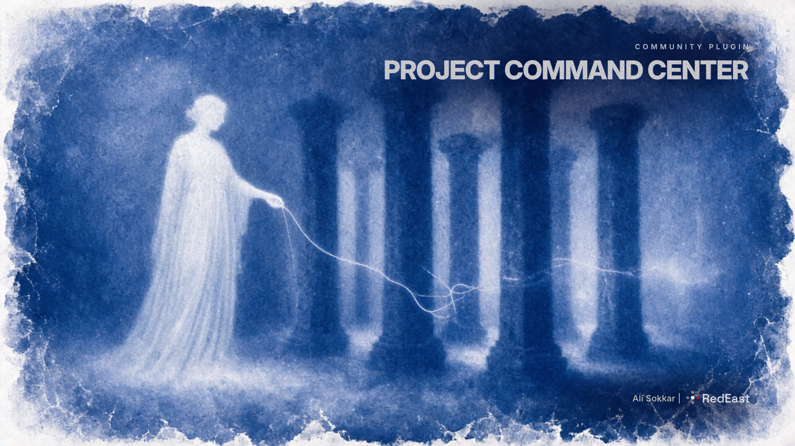
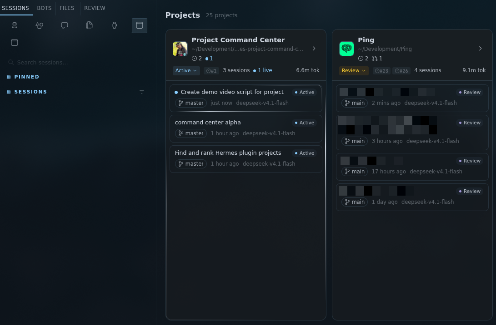
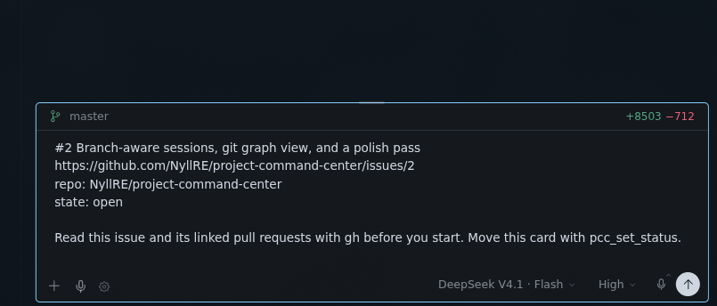
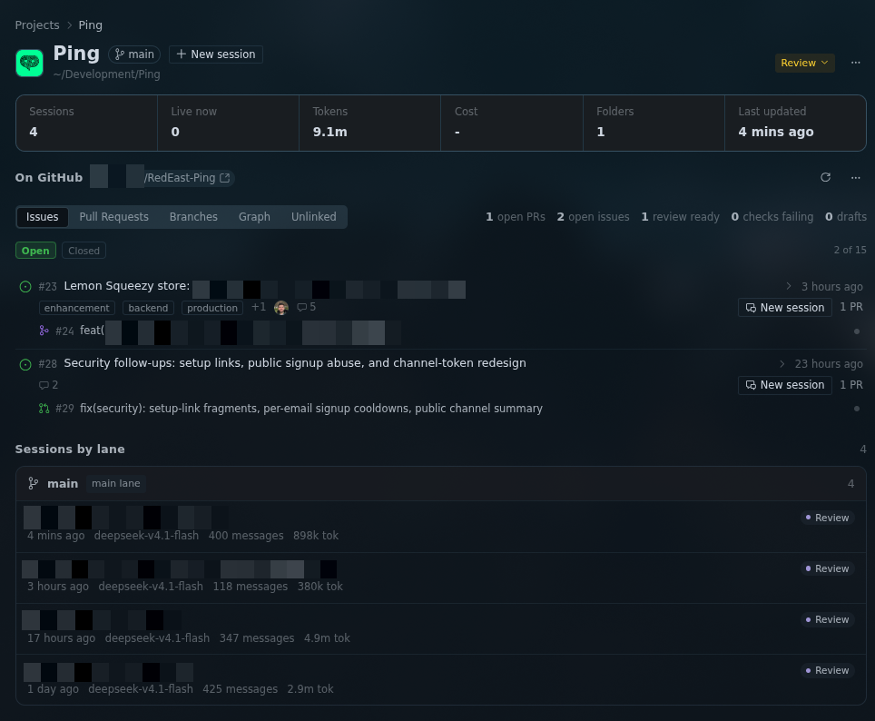
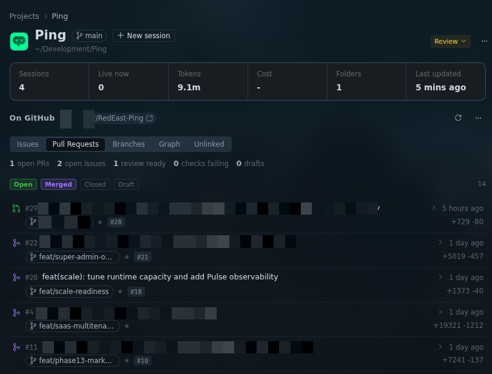
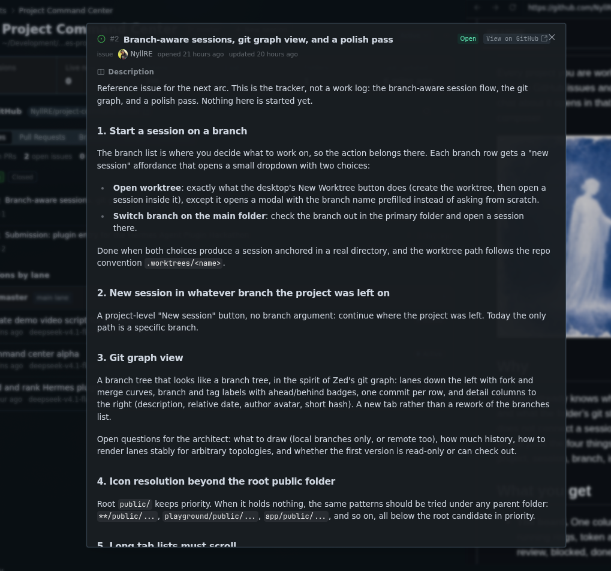
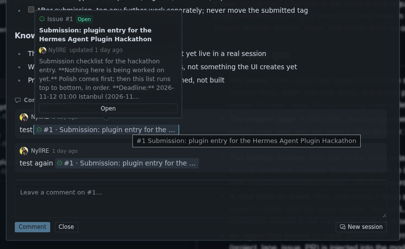
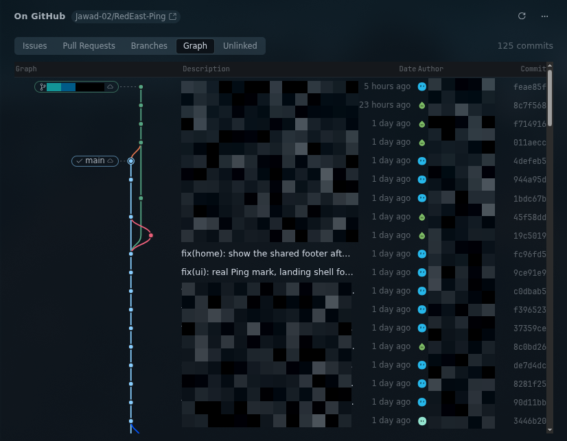
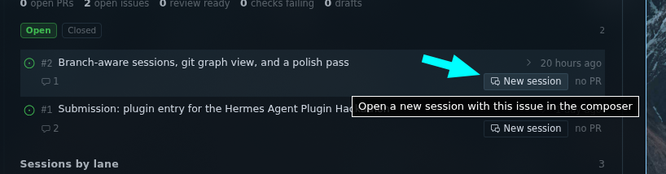

# Project Command Center

**Your projects, your agent sessions, and your GitHub issues. One board.**

Click an issue and a session opens in that repo with the issue already sitting in the composer. The agent works. When it opens the pull request, the card moves itself to Review.



**[Watch the demo on X](https://x.com/NyllRe/status/2120286833397354861)**

```bash
hermes plugins install NyllRE/project-command-center --enable
```

A Hermes Desktop plugin. If you already push to GitHub and use Hermes Projects, you are set. No new account, no new tracker, nothing to configure beyond the `gh` login you already have.

## The loop worth feeling

You stop translating between three tools.



1. The board shows every project at once: its lane, its live sessions, its branch, what is dirty, how many issues and pull requests are open.
2. You click an issue. A session opens **inside that project's folder**, with the number, title, URL and repo already in the composer. Nothing sends. You add your own first line if you want.
3. The agent reads the issue itself, works, and opens a pull request.
4. The card moves to Review on its own, and the next turn already knows which project, lane, issue and PR it is on. It never asks "which project am I in" again.

This is what you land in. The issue is already written for the agent, and nothing sends until you press send.



## The project page

Everything about one project without leaving it: token spend, session count, what is live right now, and the GitHub work in progress.



Sessions are grouped by the lane they belong to, each with its own status badge, so you can see what is blocked, what is waiting on review, and what is still moving.

## GitHub, without opening GitHub

Issues and pull requests render the way you expect: real markdown bodies, the full comment thread, reviews, checks, labels, assignees, and avatars that are actually people. You can comment and close from here.



Status filters are cumulative. Start on open, tick Merged, and see merged and open together. Icons carry the GitHub colour language: green open, purple merged or closed, red not planned, grey draft.



The whole issue, not a summary of it: markdown body, labels, assignees, and the comment thread with a composer at the bottom. Close or reopen without leaving.

`#123` references turn into chips with a preview, so a PR that mentions three issues is three clicks, not three tabs.



## History that looks like history

A commit graph with real lanes. Fork, merge, track across branches, and open any commit to read its diff, files and line changes.



## Sessions that know what they are

Each branch row gives you a session, not a chore. Start one in a worktree, or check the branch out here first. When the project is already on that branch, the menu says so instead of pretending to switch.



Sessions carry a lane: backlog, active, review, blocked, done. The board summarises them per project, so "who is on review" is a glance instead of a hunt.

## What it never does

It does not send your prompts. It does not stash, discard or force anything in your repos. It does not phone home. Avatar images, GitHub and the favicon of a project you point it at are the only things it fetches, and every one of those paths has a kill file.

The details are honest and boring, which is how you want them:

- [docs/security.md](./docs/security.md): what it reads, what it writes, what runs on your machine
- [docs/backend.md](./docs/backend.md): every route, payload and cache
- [docs/development.md](./docs/development.md): the repo, the tests, how to run it from source

## Requirements

- Hermes Desktop, installed and running
- `gh` CLI, authenticated (`gh auth login`)
- At least one Hermes Project pointing at a folder that has a git remote on GitHub

Built by Ali Sokkar.
